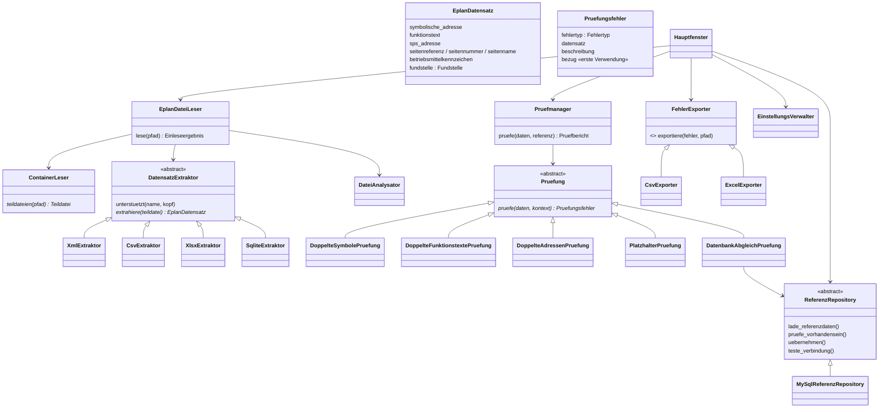

# Architektur

## Schichten und Module

```
GUI        gui.py · gui_dialoge.py · gui_modelle.py · gui_arbeiter.py      (PyQt6)
Fachlogik  eplan_parser.py · pruefer.py · export.py · dateianalyse.py
Zugriff    datenbank.py (MySQL) · einstellungen.py (INI) · logging.py
Daten      modelle.py (Datenklassen, Fehlerklassen – ohne Abhängigkeiten)
```

Abhängigkeiten zeigen nur nach unten: `modelle.py` kennt nichts, die GUI kennt alles, Parser/Prüfer/Export kennen weder Qt noch MySQL-Details. Der Prüfer hängt nur von der **Schnittstelle** `ReferenzRepository` ab (Dependency Inversion).

## Klassenmodell



### SOLID

| Prinzip | Umsetzung |
|---|---|
| **S**ingle Responsibility | Jede Prüfung, jeder Extraktor, jeder Exporter ist eine eigene Klasse; GUI, Daten und Zugriff sind getrennt |
| **O**pen/Closed | Neue Formate/Prüfungen/Exporte = neue Klasse, bestehender Code bleibt unverändert |
| **L**iskov | Alle Extraktoren/Prüfungen/Exporter sind austauschbar hinter ihrer Basisklasse |
| **I**nterface Segregation | Kleine Schnittstellen (`unterstuetzt`+`extrahiere`; `pruefe`; `exportiere`) |
| **D**ependency Inversion | Prüfer und GUI kennen `ReferenzRepository`, nicht MySQL; Leser, Prüfmanager und Repository bekommen ihre Abhängigkeiten übergeben |

## Datenfluss

```
Datei (*.elk, *.zw1, Export)
  │
  ├─► DateiAnalysator ───────────────► Strukturbericht (Protokoll, Einleseprotokoll)
  │
  ├─► ContainerLeser ─► Teildatei* ─► Extraktor (Format erkannt?)
  │       ZIP/GZIP/Ordner (*.edb)           │ ja                 │ nein → „nicht unterstützt" (gezählt)
  │                                         ▼
  │                              EplanDatensatz* (mit Fundstelle: Datei › Teildatei › Zeile)
  ▼
Einleseergebnis (Datensätze, Seiten, Teildateien, Warnungen)
  │
  ▼
Pruefmanager ──► Prüfung 1..4 (nur Datensätze)
  │         └──► Prüfung 5 ◄── ReferenzRepository ◄── MySQL (Symbol, Funktionstext)
  ▼
Pruefbericht (Fehler, ausgeführte/übersprungene Prüfungen)
  │
  ├─► Fehlerliste (GUI) ─► Fundstelle: Seitennummer, Seitenname, Quellauszug
  ├─► Export CSV / XLSX
  └─► „In Datenbank übernehmen" ─► Vorabprüfung ─► INSERT ─► automatische Neuprüfung
```

Einlesen, Prüfen und alle Datenbankzugriffe laufen in einem `QThread` (`HintergrundAufgabe`), die Oberfläche bleibt bedienbar; ein Abbruch-Ereignis wird von Parser und Prüfern kooperativ geprüft.

## Datenbankmodell

Die Referenztabelle ist **nicht** fest im Code. Datenbank, Tabelle, Feld Symbol, Feld Funktionstext und Primärschlüssel stehen in der Konfiguration. Beispiel für eine passende Tabelle (Namen frei wählbar):

```sql
CREATE TABLE symbole (
  id            INT AUTO_INCREMENT PRIMARY KEY,
  symbol        VARCHAR(100) NOT NULL,
  funktionstext VARCHAR(255) NOT NULL,
  INDEX idx_symbol (symbol),
  INDEX idx_funktionstext (funktionstext)
) CHARACTER SET utf8mb4;
```

Regeln der Übernahme („In Datenbank übernehmen"):

* Vor dem Speichern werden **Symbol**, **Funktionstext** und **Kombination** getrennt geprüft.
* Kombination vorhanden → nicht speichern („bereits vorhanden").
* Symbol *oder* Funktionstext vorhanden → nur nach ausdrücklicher Bestätigung speichern (Konflikt wird angezeigt).
* Leere Werte werden abgelehnt.
* Primärschlüssel: `AUTO_INCREMENT` oder generiert → kein Wert nötig; Ganzzahl ohne `AUTO_INCREMENT` → `MAX()+1` innerhalb der Transaktion; Schlüssel = Symbol-/Textfeld → kein Zusatzwert; anderer Typ ohne Automatik → verständliche Fehlermeldung.
* Jeder Datensatz wird in einer eigenen Transaktion gespeichert; ein Fehler bricht die übrigen nicht ab.

Die Prüfung 5 lädt die Referenz einmal komplett und vergleicht in Python:

| Fall | Ergebnis |
|---|---|
| Symbol und Funktionstext als Paar vorhanden | in Ordnung |
| Symbol fehlt | *Symbol nicht in Datenbank vorhanden* |
| Symbol vorhanden, Funktionstext fehlt | *Funktionstext nicht in Datenbank vorhanden* |
| beide einzeln vorhanden, aber nicht zusammen | *Symbol/Funktionstext stimmt nicht mit Datenbank überein* |

Fehlt beides, wird *Symbol nicht in Datenbank vorhanden* gemeldet (mit dem Zusatz, dass auch der Funktionstext fehlt). Ein leeres Symbol bzw. ein leerer Funktionstext gilt als „fehlt".

## Erweiterung

* **Neues Dateiformat / andere EPLAN-Version:** eine Klasse von `DatensatzExtraktor` ableiten (`unterstuetzt` erkennt das Format an Name und Dateikopf, `extrahiere` liefert `EplanDatensatz`-Objekte) und in `standard_extraktoren()` eintragen. Container (ZIP/GZIP/Ordner), Strukturanalyse, Dublettenbereinigung, Seitenverwaltung und Quellauszug stehen dann bereits zur Verfügung. Liegt nur eine andere Feldbezeichnung vor, genügt die Feldzuordnung im Einstellungsdialog.
* **Neue Prüfung:** von `Pruefung` ableiten und in `standard_pruefungen()` sowie `PruefEinstellungen` ergänzen.
* **Neues Exportformat (z. B. PDF):** von `FehlerExporter` ableiten und in `EXPORTER` registrieren – Menü und Dateidialog der GUI ergänzen.
* **Andere Datenbank (SQL Server, Oracle):** von `ReferenzRepository` ableiten; `erzeuge_repository()` wählt anhand eines neuen Konfigurationsfeldes „Datenbanktyp". Die Quotierung von Bezeichnern (`quotiere_bezeichner`) und die Systemkatalog-Abfragen (`information_schema`) sind dialektspezifisch und müssen je Datenbank ersetzt werden.
